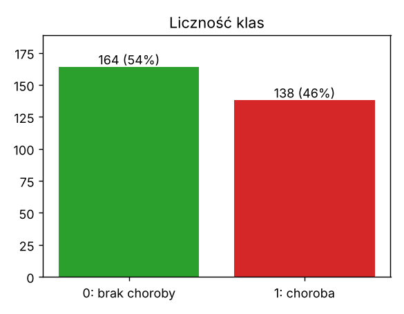
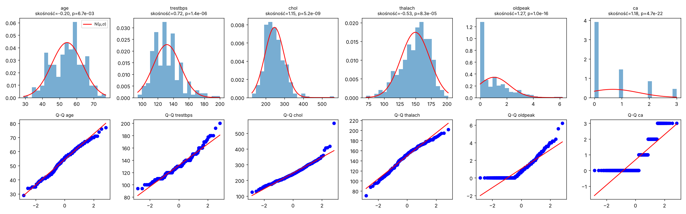
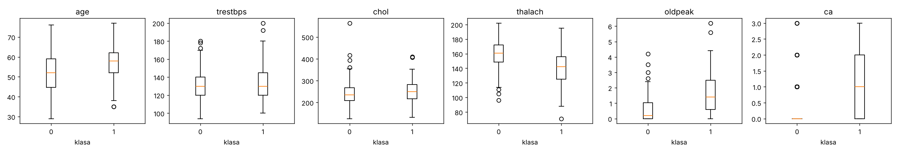
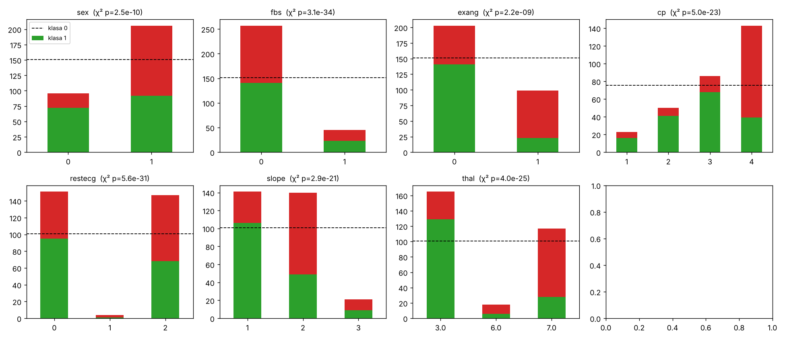
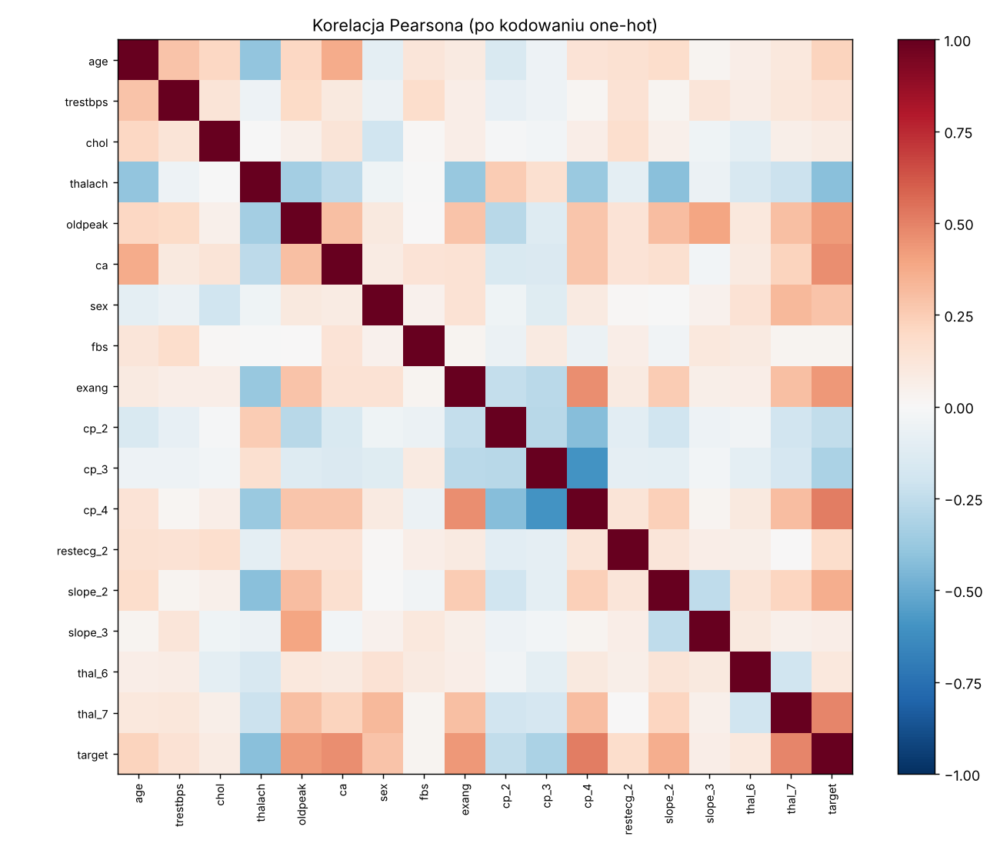

> **Oznaczenie użycia AI (pkt 11 regulaminu):** kod (`eda.py`, `data.py`) oraz szkic tego raportu
> (opis metod i zestawienie wyników) zostały przygotowane z pomocą generatywnej AI (Claude).
> Sekcja **Wnioski** jest celowo pusta: zgodnie z regulaminem wnioski formułuje student samodzielnie.

# 1. Dane

* Zbiór: UCI Heart Disease, podzbiór **Cleveland** (14 atrybutów używanych w literaturze).
  Strona UCI nie była dostępna ze środowiska, w którym liczono wyniki, więc użyto kopii tego samego
  zbioru w formacie ARFF (`dane/heart-c.arff`), przekonwertowanej do kodów UCI (`dane/heart_cleveland.csv`).
* 303 wiersze, w tym **1 duplikat** (usunięty) → **302 próbki**.
* Zmienna celu: `num` (0–4) zbinaryzowana do `target` = 0 (brak choroby) / 1 (choroba, num ≥ 1) – standardowe ujęcie problemu.
* Cechy liczbowe: `age, trestbps, chol, thalach, oldpeak, ca` (ca – liczba naczyń 0–3, porządkowa).
  Binarne: `sex, fbs, exang`. Kategoryczne nominalne: `cp, restecg, slope, thal`.

# 2. Czy zbiór jest zbalansowany?

| klasa | liczność | udział |
|---|---|---|
| 0 – brak choroby | 164 | 54% |
| 1 – choroba | 138 | 46% |

Stosunek klasy mniejszej do większej = 0,84 – zbiór jest **w przybliżeniu zbalansowany**.
Klasyfikator „zawsze 0” ma accuracy 0,55, więc accuracy samo w sobie jest mało informatywne – dlatego raportujemy też precision, recall i F1.

{width=45%}

# 3. Średnie i odchylenia cech liczbowych; normalność rozkładów

| cecha | średnia | odch. std | mediana | min–max | skośność | Shapiro-Wilk p |
|---|---|---|---|---|---|---|
| age | 54,4 | 9,0 | 55,5 | 29–77 | −0,20 | 0,007 |
| trestbps | 131,6 | 17,6 | 130 | 94–200 | 0,72 | < 0,001 |
| chol | 246,5 | 51,8 | 240,5 | 126–564 | 1,15 | < 0,001 |
| thalach | 149,6 | 22,9 | 152,5 | 71–202 | −0,53 | < 0,001 |
| oldpeak | 1,04 | 1,16 | 0,8 | 0–6,2 | 1,27 | < 0,001 |
| ca | 0,67 | 0,94 | 0 | 0–3 | 1,18 | < 0,001 |

Test Shapiro-Wilka odrzuca normalność dla wszystkich cech (p < 0,05). Histogramy i wykresy Q-Q pokazują jednak różny stopień odstępstwa:
`age` jest bardzo bliski normalnemu, `thalach` i `trestbps` umiarkowanie skośne, `chol` ma ciężki prawy ogon (wartość odstająca 564),
a `oldpeak` i `ca` są wyraźnie nienormalne (masa prawdopodobieństwa w zerze, ca jest dyskretne).
Cechy mają bardzo różne skale (od ~1 do ~250) – to argument za standaryzacją.



Średnie w klasach (0 / 1): age 52,6 / 56,6; thalach 158,4 / 139,1; oldpeak 0,59 / 1,59; ca 0,27 / 1,15;
chol 242,6 / 251,1; trestbps 129,3 / 134,4.



# 4. Cechy kategoryczne – czy rozkład jest równomierny?

Test χ² zgodności z rozkładem równomiernym odrzuca równomierność dla wszystkich cech (p < 10⁻⁸):

| cecha | liczności kategorii | odsetek chorych w kategoriach |
|---|---|---|
| sex (0 K / 1 M) | 96 / 206 | 25% / 55% |
| fbs (0/1) | 257 / 45 | 45% / 49% |
| exang (0/1) | 203 / 99 | 31% / 77% |
| cp (1/2/3/4) | 23 / 50 / 86 / 143 | 30% / 18% / 21% / 73% |
| restecg (0/1/2) | 151 / **4** / 147 | 37% / 75% / 54% |
| slope (1/2/3) | 141 / 140 / 21 | 25% / 65% / 57% |
| thal (3/6/7) | 165 / 18 / 117 | 22% / 67% / 76% |

Szczególnie nierównomierne: `restecg=1` (tylko 4 próbki), `fbs`, `slope=3`, `thal=6`, `cp=1`.
`fbs` prawie nie różnicuje klas, natomiast `cp=4`, `exang`, `thal=7` silnie wiążą się z chorobą.



# 5. Braki danych i strategia uzupełniania

Braki występują w 6 wierszach (2%): `ca` – 4, `thal` – 2. Możliwe strategie: usunięcie wierszy, imputacja
dominantą/medianą, kNN, osobna kategoria / kolumna-wskaźnik braku.
**Wybrana strategia:** imputacja **dominantą** liczoną tylko na zbiorze treningowym (obie cechy są dyskretne,
braków jest bardzo mało, więc wpływ na rozkład jest pomijalny, a nie tracimy próbek z małego zbioru).
Wariant z kolumnami-wskaźnikami braków jest zaimplementowany (`missing_indicators=True`) i przebadany w ćwiczeniu 2.

# 6. Kodowanie i normalizacja (`data.py`, klasa `Preprocessor`)

1. `restecg=1` (4 próbki) łączone z `restecg=2` w kategorię „nieprawidłowe EKG”.
2. Imputacja braków dominantą.
3. One-hot dla `cp, restecg, slope, thal` z pominięciem pierwszej kategorii (unikamy współliniowości z wyrazem wolnym).
4. Standaryzacja z-score wszystkich kolumn: (x − μ)/σ.
5. Wszystkie statystyki (dominanty, μ, σ) liczone **tylko na zbiorze treningowym** i stosowane do val/test – brak wycieku danych.

Wynik: 17 cech rzeczywistych. Podział warstwowy 60/20/20 (train 181 / val 61 / test 60, seed 42), używany też w ćw. 2.

Najsilniej skorelowane z klasą (|r| Pearsona): cp_4 0,52; thal_7 0,49; ca 0,46; exang 0,44; oldpeak 0,43; thalach −0,42.

{width=80%}

# 7. Baseline (scikit-learn)

Modele uczone na train+val (242 próbki), ocena na teście (60 próbek); dodatkowo 5-krotna walidacja krzyżowa (F1).

| model | accuracy | precision | recall | F1 | ROC AUC | CV F1 |
|---|---|---|---|---|---|---|
| Dummy (klasa większościowa) | 0,550 | 0,000 | 0,000 | 0,000 | 0,500 | 0,000 |
| **LogisticRegression** | **0,817** | 0,786 | 0,815 | **0,800** | 0,901 | 0,815 ± 0,026 |
| RandomForest (300 drzew) | 0,800 | 0,778 | 0,778 | 0,778 | 0,897 | 0,813 ± 0,034 |

Jako baseline przyjmujemy **regresję logistyczną ze scikit-learn: F1 ≈ 0,80 na teście, ≈ 0,82 w CV**.

# 8. Wnioski

*(do uzupełnienia samodzielnie – pkt 11 regulaminu).* Pytania pomocnicze: czy niezbalansowanie wymaga
ważenia klas? które cechy wymagają szczególnej uwagi przy normalizacji i dlaczego? czy wybrana strategia
braków może zaburzyć wyniki? czemu prosty model liniowy wypada tu tak samo dobrze jak las losowy?

# Uruchomienie

```
pip install numpy pandas matplotlib scipy scikit-learn
python eda.py
```
