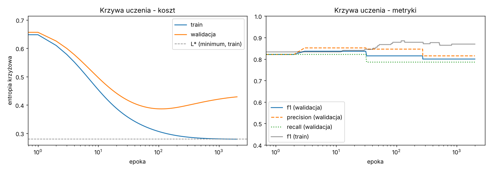
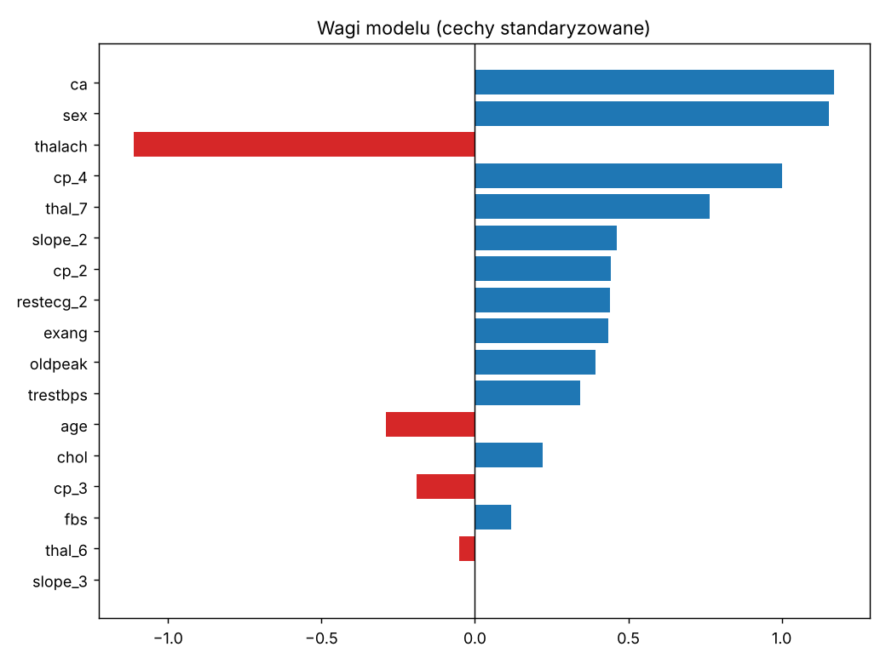
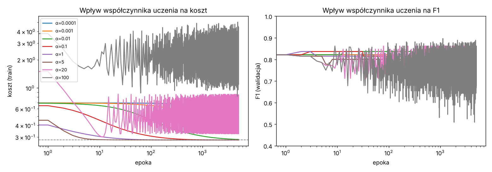
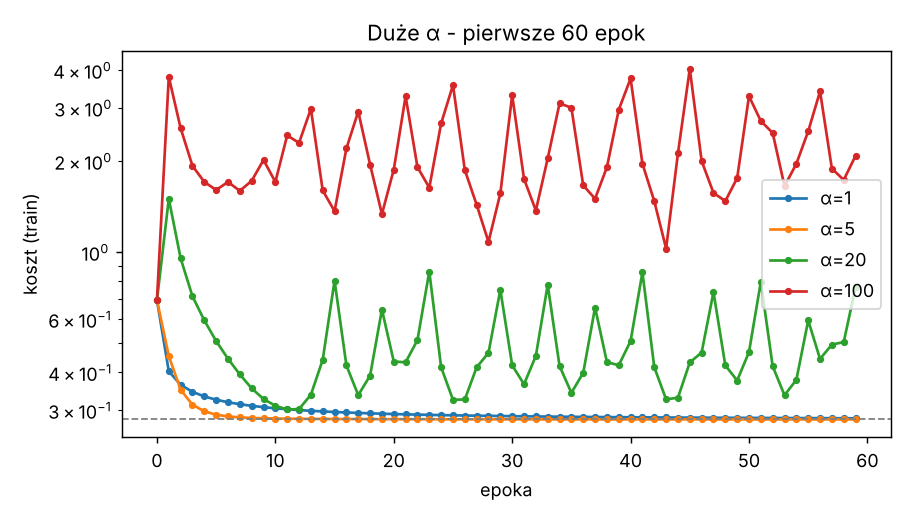
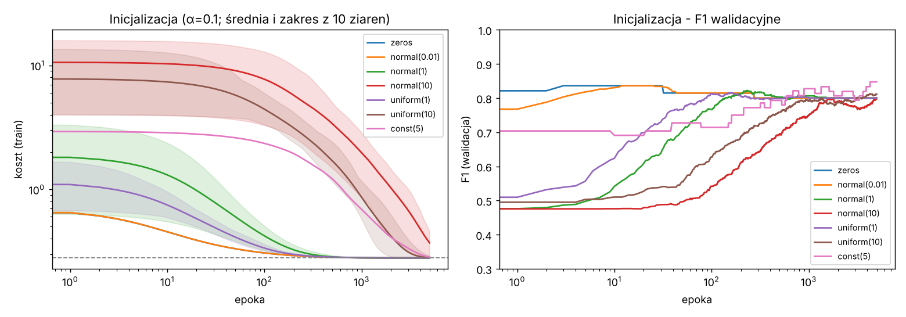
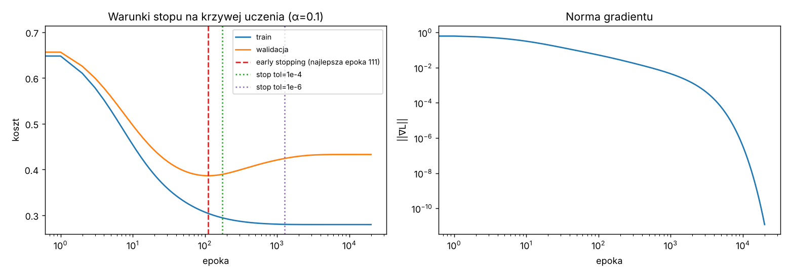
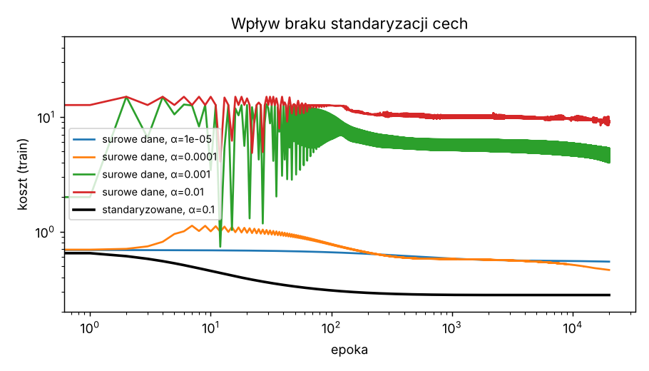
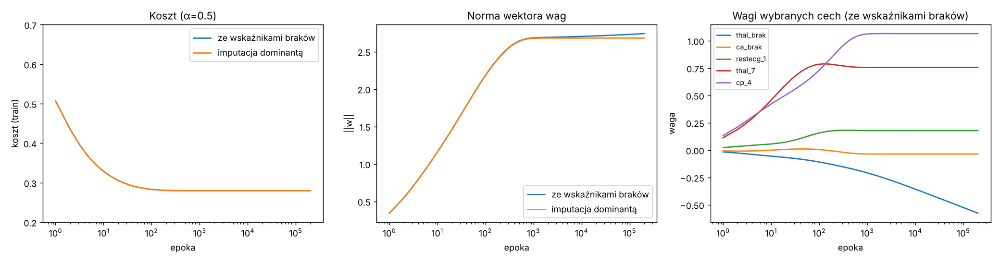

> **Oznaczenie użycia AI (pkt 11 regulaminu):** kod (`logreg.py`, `data.py`) oraz szkic tego raportu
> (opis metody, eksperymentów i zestawienie wyników) przygotowano z pomocą generatywnej AI (Claude).
> Sekcja **Wnioski** jest celowo pusta: zgodnie z regulaminem wnioski formułuje student samodzielnie.

# 1. Model i implementacja

Regresja logistyczna zaimplementowana od zera w NumPy (bez gotowych metod uczenia), klasa `LogisticRegressionGD`:

* model: p(x) = σ(Wx + b), σ(z) = 1/(1+e^(−z)) (wersja stabilna numerycznie),
* koszt: średnia entropia krzyżowa L = −1/N Σ [y ln p + (1−y) ln(1−p)],
* gradient: ∂L/∂wᵢ = −1/N Σ (y − p) xᵢ, ∂L/∂b = −1/N Σ (y − p),
* aktualizacja: w ← w − α ∂L/∂w (pełny batch gradient descent),
* warunki stopu: stała liczba epok / |L_t − L_(t−1)| < tol / early stopping na koszcie walidacyjnym (z przywróceniem najlepszych wag),
* w każdej epoce logowane są: koszt i F1/precision/recall (train i walidacja) oraz ‖∇L‖ – z tego powstają krzywe uczenia.

Metryki precision/recall/F1 liczone dla klasy pozytywnej (1 = choroba), próg 0,5.

**Dane:** preprocessing z ćwiczenia 1 (`data.py`, ten sam co w ćw. 1): imputacja dominantą, one-hot, standaryzacja, 17 cech;
podział warstwowy train 181 / val 61 / test 60.

**Minimum globalne jako punkt odniesienia:** ponieważ koszt jest wypukły, wyznaczono minimum
długim treningiem (α = 0,5, do |ΔL| < 10⁻¹⁴): **L\* = 0,279698**, ‖∇L‖ = 1,4·10⁻⁷.
Kontrola: `sklearn.LogisticRegression` bez regularyzacji daje ten sam koszt, a jej wagi różnią się od naszych o 1,4·10⁻⁵ (norma) – implementacja jest poprawna.
**Kryterium zbieżności** w tabelach: pierwsza epoka, w której L ≤ L\* + 10⁻³.

# 2. Model bazowy (α = 0,1, inicjalizacja zerowa, 2000 epok)

| zbiór | precision | recall | F1 | accuracy |
|---|---|---|---|---|
| train | 0,897 | 0,843 | 0,870 | 0,884 |
| walidacja | 0,815 | 0,786 | 0,800 | 0,820 |
| **test** | **0,786** | **0,815** | **0,800** | **0,817** |

Wynik na teście jest identyczny z baseline'em sklearn z ćwiczenia 1 (F1 = 0,800) – oba modele trafiają w to samo minimum. Zbieżność do L\* + 10⁻³ po 922 epokach.



{width=65%}

# 3. Wpływ współczynnika uczenia α (inicjalizacja zerowa, 5000 epok)

| α | koszt końcowy | epoki do zbieżności | oscylacje | F1 val | F1 test |
|---|---|---|---|---|---|
| 0,0001 | 0,5334 | nie zbiegł | nie | 0,836 | 0,807 |
| 0,001 | 0,3325 | nie zbiegł | nie | 0,815 | 0,821 |
| 0,01 | 0,2831 | nie zbiegł (blisko) | nie | 0,800 | 0,800 |
| 0,1 | 0,27970 | 922 | nie | 0,800 | 0,800 |
| 1 | 0,27970 | 91 | nie | 0,800 | 0,800 |
| 5 | 0,27970 | **14** | nie | 0,800 | 0,800 |
| 20 | 0,3267 | nigdy | **tak** | 0,733 | 0,857 |
| 100 | 3,0185 | nigdy | **tak** | 0,679 | 0,836 |

Obserwacje:

* α ≤ 0,01: koszt maleje monotonicznie, ale bardzo wolno – po 5000 epokach model nie osiąga minimum.
* 0,1 ≤ α ≤ 5: zbieżność do tego samego L\*; liczba epok maleje prawie odwrotnie proporcjonalnie do α (922 → 91 → 14).
* α ≥ 20: koszt nie zbiega – oscyluje (dla α = 20 między ~0,30 a ~0,85; dla α = 100 między ~1 a ~5), krok „przeskakuje” minimum. Minimum istnieje i jest jedno, ale optymalizator do niego nie dochodzi.
* F1 przy małym α bywa chwilowo wyższe niż w minimum (np. α = 0,0001: F1 test 0,807) – F1 nie jest minimalizowaną funkcją, więc niepełne dopasowanie nie musi szkodzić metrykom.



{width=65%}

# 4. Wpływ rozkładu inicjalizacji (α = 0,1, 5000 epok, 10 ziaren dla rozkładów losowych)

| inicjalizacja | koszt początkowy | koszt końcowy (śr.) | epoki do zbieżności (śr.) | nie zbiegło (z 10) | F1 val po 100 ep. | F1 test końcowe | ‖w − w\*‖ |
|---|---|---|---|---|---|---|---|
| zera | 0,693 | 0,27970 | 922 | 0/1 | 0,815 | 0,800 | 0,006 |
| N(0; 0,01) | 0,694 | 0,27970 | 921 | 0 | 0,815 | 0,800 | 0,006 |
| N(0; 1) | 1,88 | 0,27970 | 891 | 0 | 0,766 | 0,800 | 0,004 |
| U(−1; 1) | 1,15 | 0,27970 | 983 | 0 | 0,813 | 0,800 | 0,006 |
| U(−10; 10) | 7,80 | 0,2812 | 3904 | 2 | 0,627 | 0,804 | 0,34 |
| N(0; 10) | 10,60 | 0,3702 ± 0,064 | – | **10** | 0,542 | 0,830 | 4,62 |
| stała 5 | 2,93 | 0,2840 | – | 1/1 | 0,714 | 0,822 | 0,95 |

Obserwacje:

* Małe inicjalizacje (zera, N(0; 0,01), N(0;1), U(−1;1)) – wszystkie dochodzą do tego samego minimum (różnice w koszcie ~10⁻⁷, w wagach ~10⁻³), w podobnej liczbie epok.
* Duże inicjalizacje (σ = 10, U(−10;10), stała 5) zaczynają z ogromnym kosztem (do ~10) i nasyconą sigmoidą. Przy nasyceniu (p ≈ 0 lub 1) dla źle sklasyfikowanych próbek gradient jest ograniczony, a dla dobrze sklasyfikowanych ≈ 0, więc postęp jest bardzo wolny: N(0;10) w żadnym z 10 przebiegów nie osiągnął minimum w 5000 epokach.
* Odległość ‖w − w\*‖ maleje jednak cały czas – przy dłuższym treningu wszystkie inicjalizacje zbiegają do tego samego punktu (wypukłość: brak lokalnych minimów). Zła inicjalizacja **wydłuża** uczenie, nie zmienia celu.



# 5. Liczba epok i warunek stopu (α = 0,1)

| warunek stopu | epoki | koszt train | koszt val | F1 val | P test | R test | F1 test |
|---|---|---|---|---|---|---|---|
| stałe 10 epok | 10 | 0,454 | 0,497 | 0,836 | 0,767 | 0,852 | 0,807 |
| stałe 100 epok | 100 | 0,307 | 0,387 | 0,815 | 0,778 | 0,778 | 0,778 |
| stałe 1000 epok | 1000 | 0,2805 | 0,421 | 0,800 | 0,786 | 0,815 | 0,800 |
| stałe 20000 epok | 20000 | 0,2797 | 0,433 | 0,800 | 0,786 | 0,815 | 0,800 |
| |ΔL| < 10⁻⁴ | 175 | 0,294 | 0,390 | 0,815 | 0,786 | 0,815 | 0,800 |
| |ΔL| < 10⁻⁶ | 1271 | 0,2801 | 0,424 | 0,800 | 0,786 | 0,815 | 0,800 |
| early stopping (patience 50) | 161 (najlepsza: 111) | 0,304 | 0,386 | 0,815 | 0,778 | 0,778 | 0,778 |

Obserwacje:

* Koszt treningowy maleje monotonicznie do L\*, a ‖∇L‖ spada od ~0,7 do ~10⁻¹¹ – zbieżność jest stabilna.
* **Koszt walidacyjny ma minimum ok. epoki 111 (0,386) i potem rośnie do 0,433** – mimo wypukłości model zaczyna nadmiernie dopasowywać się do 181 próbek treningowych (rosną wagi, predykcje stają się zbyt pewne). F1 prawie się przy tym nie zmienia (metryki zależą tylko od strony progu 0,5, a koszt także od pewności predykcji).
* Kryterium |ΔL| < 10⁻⁴ zatrzymuje po 175 epokach przy niemal tych samych metrykach co pełny trening – kolejne tysiące epok niczego nie poprawiają w metrykach.
* Na 60-próbkowym zbiorze testowym zmiana F1 o 0,02 to zmiana klasyfikacji jednej próbki – różnice między warunkami stopu mieszczą się w szumie.



# 6. Dodatkowo: zła parametryzacja danych

## 6.1 Brak standaryzacji cech

Ten sam model na surowych cechach (chol ~250, oldpeak ~1). Minimum kosztu jest to samo (standaryzacja to przekształcenie afiniczne), zmienia się tylko kształt funkcji kosztu:
wskaźnik uwarunkowania XᵀX rośnie z **38** do **4,8·10⁶**.

| α (surowe dane, 20000 epok) | koszt końcowy | F1 test |
|---|---|---|
| 10⁻⁵ | 0,547 | 0,678 |
| 10⁻⁴ | 0,463 | 0,714 |
| 10⁻³ | 3,99 (oscylacje) | 0,486 |
| 10⁻² | 8,94 (oscylacje) | 0,486 |
| standaryzowane, α = 0,1 | 0,280 | 0,800 |

Nie istnieje α, które działa dobrze: krok wystarczająco mały dla „stromego” kierunku (chol) jest zdecydowanie za mały dla „płaskich” kierunków – po 20000 epokach koszt jest daleko od minimum.

{width=70%}

## 6.2 Minimum „w nieskończoności”: kolumny-wskaźniki braków

Wariant preprocessingu, w którym braki koduje się dodatkowymi kolumnami 0/1 (`ca_brak`, `thal_brak`). W zbiorze treningowym `thal_brak` ma tylko **jedną** jedynkę (próbka z klasy 0) – w tym kierunku dane są liniowo separowalne. Koszt można wtedy obniżać w nieskończoność, przesuwając wagę `thal_brak` → −∞, więc **minimum nie jest osiągane dla skończonych wag**.

Przebieg (α = 0,5, 200 000 epok): koszt praktycznie stały (0,27953 → 0,27953), ale ‖w‖ rośnie bez końca (2,684 → 2,740), a waga `thal_brak` maleje mniej więcej liniowo względem log(epoki) (ok. −0,2 po 10³ epok, −0,57 po 2·10⁵ epok) i nie zatrzymuje się; przy imputacji dominantą ‖w‖ stabilizuje się na 2,681 już po ~10³ epokach.
Warunek stopu oparty na |ΔL| zatrzyma taki trening, ale wektor wag nigdy nie zbiegnie.



# 7. Wnioski

*(do uzupełnienia samodzielnie – pkt 11 regulaminu).* Pytania z treści zadania, na które warto odpowiedzieć na podstawie powyższych wyników:

1. Czy klasyfikator liniowy zawsze zbiega do globalnego minimum? (por. sekcje 3, 4, 6.2)
2. Czy zła parametryzacja (α, inicjalizacja, skala cech) uniemożliwia zbieżność, czy tylko ją wydłuża? Które przypadki należą do której grupy?
3. Jaki warunek stopu wybrać i dlaczego minimum kosztu treningowego nie oznacza najlepszego modelu?

# Uruchomienie

```
pip install numpy pandas matplotlib scikit-learn
python logreg.py      # ok. 2,5 min, wykresy -> figures/, liczby -> results.json
```
