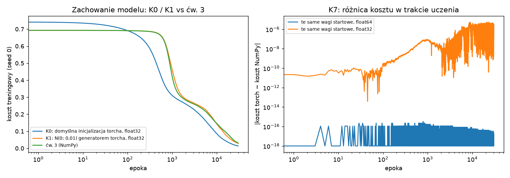
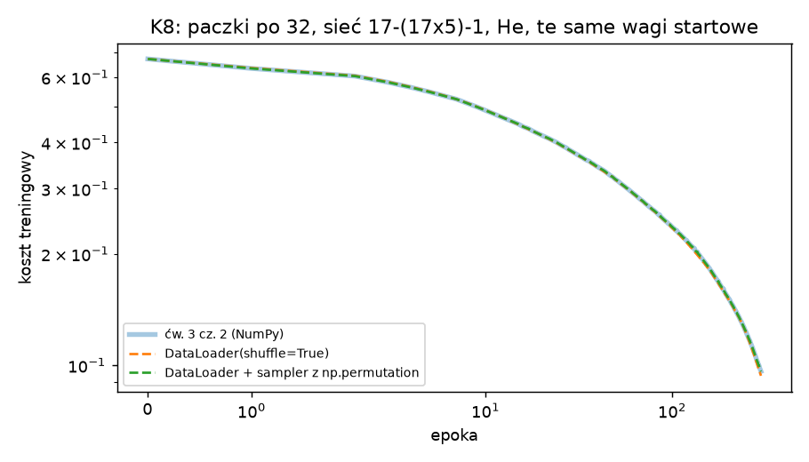
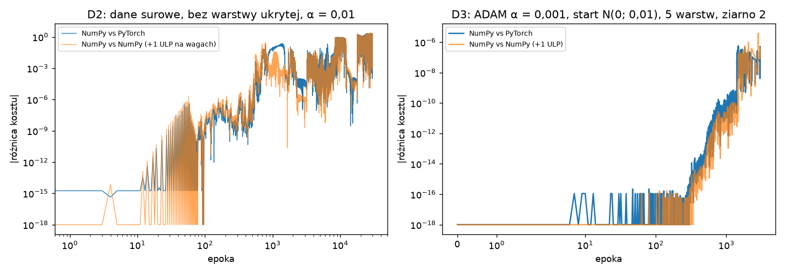
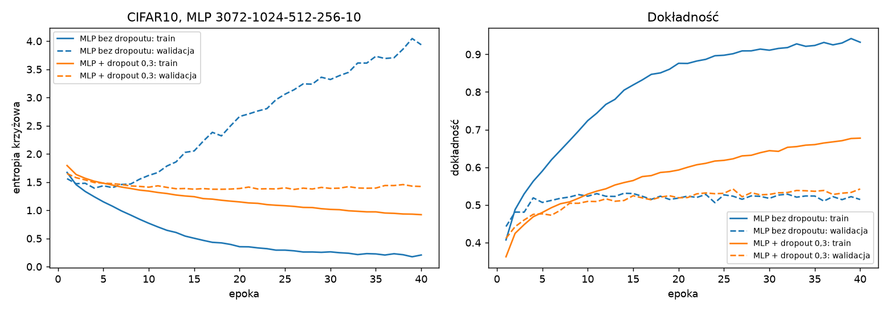
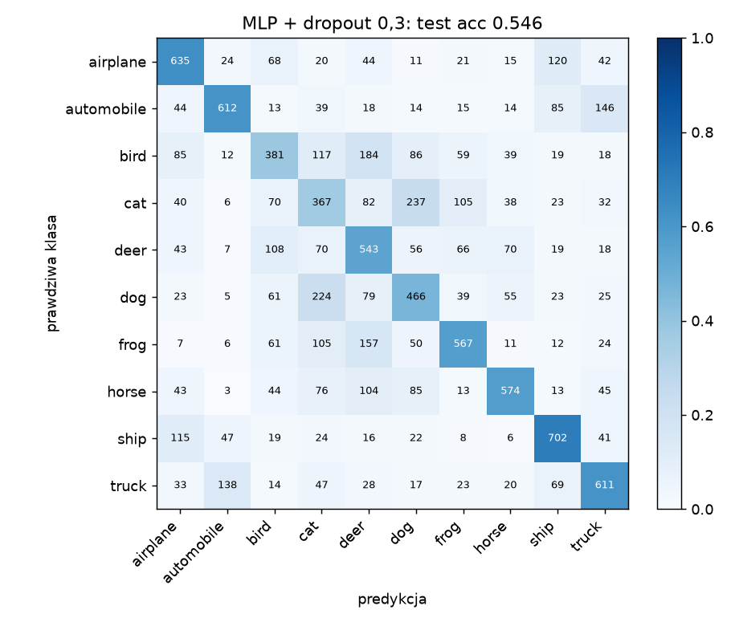

# Ćwiczenie 4 – sieć z ćwiczenia 3 w PyTorch i baseline na CIFAR10

*Kod i raport przygotowane z pomocą AI (Claude), zgodnie z pkt 11 regulaminu.*

## 1. Cel

1. Odtworzyć w PyTorch sieć z ćwiczenia 3 (MLP Linear → ReLU → … → Linear → sigmoida + entropia krzyżowa,
   zbiór Heart Disease, 13 cech po kodowaniu → 17 wejść), powtórzyć wszystkie eksperymenty z ćw. 3 (cz. 1 i cz. 2)
   i uzyskać możliwie te same wyniki. Opisać to jako proces: jakie różnice implementacyjne mogą zmienić wynik,
   jak je po kolei usuwano i jak to sprawdzano – na poziomie zachowania modelu, metryk, wag i gradientów.
2. Większą siecią sklasyfikować CIFAR10 – wynik będzie baselinem w następnym ćwiczeniu.

## 2. Odpowiedniki elementów z ćw. 3

| ćw. 3 (NumPy, własna implementacja) | ćw. 4 (PyTorch) | uwagi |
|---|---|---|
| `Linear`: `W` (n_out, n_in), `y = X Wᵀ + b` | `nn.Linear` | `weight` ma ten sam kształt (out, in) – wagi kopiujemy bez transpozycji |
| `ReLU`: `X * [X > 0]`, backward `dY * maska` | `nn.ReLU` | różnica tylko dla `X = −∞` (rozdz. 5.1) |
| `SigmoidBCE`: koszt `bce()` z obcięciem p do [1e‑12, 1−1e‑12], backward `(p − y)/N` | `nn.BCEWithLogitsLoss` | gradient identyczny; wartość różni się dopiero dla \|z\| > 27,6 (K5) |
| `backward()` każdego modułu, wywoływane w odwrotnej kolejności | `loss.backward()` (autograd, graf obliczeniowy) | `z.grad_fn`: `SqueezeBackward1` → `AddmmBackward0` → `ReluBackward0` → `AddmmBackward0` → `AccumulateGrad` (wagi) |
| `w -= α·dw` | `torch.optim.SGD` + `zero_grad()` | gradient w `.grad` się akumuluje, trzeba go zerować |
| własny `Adam` | `torch.optim.Adam` | ta sama formuła z korekcją biasu, `eps` dodawany do `√v̂` |
| `rng.permutation(n)` co epokę + pętla po paczkach | `DataLoader` + własny `Sampler` (`NumpyPermutationBatches`) | natywne `shuffle=True` daje inną kolejność (K8) |
| `activation_stds()` – osobne przejście w przód | `register_forward_hook` na warstwach liniowych | bez przepisywania `forward()` |

Pliki: `torch_mlp.py` (model, uczenie, metryki), `equivalence.py` (kroki K0–K8), `replicate.py`
(wszystkie eksperymenty z ćw. 3), `compare.py` (zestawienie z `results.json` z ćw. 3), `diagnose.py`
(wyjaśnienie pozostałych różnic), `cifar10.py`. Kod z ćw. 3 jest skopiowany bez zmian jako `cw3_mlp.py`
i `cw3_optim.py` – służy jako punkt odniesienia (i do losowania wag startowych).

## 3. Proces: od naiwnego portu do zgodności bit w bit

Najpierw sprawdzono, że kod z ćw. 3 uruchomiony ponownie daje dokładnie liczby zapisane w `results.json`
(model bazowy 17‑17‑1: koszt końcowy 0,030966, najmniejszy koszt walidacyjny 0,39306 w epoce 1783,
wyjście z plateau w epoce 724, F1 test 0,764) – jest to więc stabilny punkt odniesienia.
Następnie usuwano różnice po jednej (wyniki: `results_equivalence.json`, `figures/eq_*.png`).

**Zidentyfikowane różnice implementacyjne, które mogą zmienić wynik:**

1. inicjalizacja wag – rozkład (domyślnie Kaiming‑uniform w `nn.Linear`) i losowy bias,
2. generator liczb losowych (torch ≠ NumPy przy tym samym ziarnie),
3. precyzja: PyTorch domyślnie float32, NumPy float64,
4. kolejność sumowania w mnożeniu macierzy (inne biblioteki BLAS) – błędy rzędu 1e‑16,
5. funkcja kosztu: obcięcie p w `bce()` vs dokładny `BCEWithLogitsLoss`; pułapka `sigmoid` + `BCELoss`,
6. szczegóły optymalizatora (gdzie jest `eps` w Adamie, korekcja biasu),
7. kolejność przykładów w paczkach,
8. zachowanie na wartościach nieskończonych (ReLU jako mnożenie przez maskę),
9. kolejność operacji w pętli uczenia (koszt i najlepsze wagi liczone przed krokiem czy po nim).

| krok | co zmieniono | poziom sprawdzenia | wynik |
|---|---|---|---|
| K0 | naiwny port jak w tutorialu: domyślna inicjalizacja `nn.Linear`, float32 | zachowanie, metryki (3 ziarna) | **inne zachowanie**: std wag 0,143 zamiast 0,01, bias ≠ 0 → brak długiego plateau (wyjście w epokach 291 / 120 / 38 zamiast 724 / 814 / 759), koszt końcowy 0,014 zamiast 0,027, min. kosztu walidacyjnego w epoce ~1250 zamiast ~1810; F1 test podobne (0,76–0,79) |
| K1 | inicjalizacja jak w ćw. 3: N(0; 0,01), bias 0, ale generatorem torcha | zachowanie, metryki | **to samo zachowanie, inne liczby**: plateau 737 / 923 / 759, min. kosztu walidacyjnego 0,390–0,400 (NumPy 0,393–0,399) w epokach 1730–1939 (NumPy 1783–1854); te same wnioski, ale nie te same liczby – inne wagi startowe |
| K2 | **te same wagi** (skopiowane z obiektu `MLP` z ćw. 3), float32 | wagi, wyjście, koszt | wagi różnią się o 9e‑10 (zaokrąglenie do float32), logity względnie o 1,2e‑7, koszt o 4e‑8 |
| K3 | float64 | wagi, wyjście, koszt | wagi identyczne (0), logity różnią się o 1,7e‑18 (2,9e‑16 względnie), koszt o 1,1e‑16 (1 ULP); dla wytrenowanej sieci te same predykcje |
| K4 | autograd vs ręczny `backward()` | gradienty | float64: max \|ΔdW\| = 1,7e‑18 … 4,2e‑17 (względnie ≤ 1,5e‑15) dla sieci na starcie, wytrenowanej i 3‑warstwowej z He; float32: względnie ~1e‑7. Gradient dL/dz identyczny – `BCEWithLogitsLoss` daje (σ(z) − y)/N |
| K5 | funkcja kosztu przy skrajnych logitach | koszt, gradient | patrz niżej |
| K6 | `torch.optim.SGD` / `Adam` vs własne GD / Adam, 50 kroków na paczkach | wagi po kroku | różnica wag po 1 / 10 / 50 krokach: SGD 6e‑17 / 6e‑17 / 1e‑16, Adam 6e‑17 / 3e‑16 / 4e‑16 – ta sama formuła |
| K7 | całe uczenie (30 000 epok, pełny zbiór) z tymi samymi wagami startowymi | krzywa kosztu, wagi, metryki | **float64**: max różnica kosztu w całym przebiegu 3,3e‑16, wagi końcowe 1,1e‑15, ta sama epoka najlepszych wag (1783), identyczne macierze pomyłek. **float32**: różnica rośnie z 1e‑10 do ~6e‑6 (wykres), wagi końcowe 1,5e‑4, ale metryki, epoka 1783 i wyjście z plateau 724 te same |
| K8 | uczenie paczkami po 32: `DataLoader(shuffle=True)` vs sampler odtwarzający `np.permutation` | krzywa kosztu, wagi | natywny `shuffle` – inna kolejność przykładów: wagi po 300 epokach różnią się o 0,048, koszt końcowy 0,0937 vs 0,0963 (podobny przebieg). Własny sampler – różnica kosztu 1,7e‑16, wag 6,7e‑16 |

**K5 – funkcja kosztu.** Dla przykładu z y = 1 i logitem z:

| z | `bce()` ćw. 3 | `BCEWithLogitsLoss` | `sigmoid` + `BCELoss` | gradient ćw. 3 | gradient `BCEWithLogits` | gradient `sigmoid`+`BCELoss` |
|---|---|---|---|---|---|---|
| −50 | 27,63 | 50,00 | 50,00 | −1 | −1 | **−1,9e‑10** |
| −30 | 27,63 | 30,00 | 30,00 | −1 | −1 | **−0,094** |
| −10 | 10,00 | 10,00 | 10,00 | −1 | −1 | −1 |
| 0 | 0,693 | 0,693 | 0,693 | −0,5 | −0,5 | −0,5 |

* Wartość kosztu: `bce()` z ćw. 3 obcina p do 1e‑12, więc koszt jednego przykładu nie przekroczy 27,6;
  `BCEWithLogitsLoss` liczy dokładnie. Do raportowania użyto więc wersji z obcięciem (`bce_report(mode="clip")`),
  a do uczenia `BCEWithLogitsLoss` – gradient jest wtedy identyczny z ćw. 3, bo w ćw. 3 backward
  `(p − y)/N` też ignoruje obcięcie. W praktyce w eksperymentach z ćw. 3 \|z\| nie przekroczyło ~25
  (najbardziej przeuczona sieć, 256 neuronów), więc obie wersje dają ten sam koszt (różnica 1,5e‑14).
* Pułapka: osobno `torch.sigmoid` + `nn.BCELoss` – gdy sigmoida się nasyca, σ(z) zaokrągla się do 0 lub 1
  i gradient znika (dla z = −50 jest 5e9 razy za mały), choć model myli się maksymalnie. Dlatego wersja
  „sigmoida w modelu + BCELoss” nie odtworzyłaby uczenia z ćw. 3, a `BCEWithLogitsLoss` (odpowiednik
  `SigmoidBCE`, która też łączy oba kroki) tak.

**K9 – kolejność operacji w pętli.** W ćw. 3 w każdej epoce najpierw liczony jest koszt i gradient dla
aktualnych wag, potem koszt walidacyjny (i ewentualny zapis najlepszych wag), dopiero potem krok. Pętla
z tutoriala robi krok przed jakimkolwiek pomiarem walidacyjnym, więc „najlepsza epoka” byłaby przesunięta o 1.
`fit_full()` i `train_modes()` zachowują kolejność z ćw. 3 – stąd ta sama epoka najlepszych wag (1783).

Wniosek z kroków K0–K9: po wyrównaniu wag startowych, precyzji, funkcji kosztu i kolejności przykładów
jedyną różnicą jest kolejność sumowania w mnożeniu macierzy – błąd na poziomie 1 ULP (~1e‑16), który
w stabilnym uczeniu nie rośnie (K7, float64).





## 4. Wszystkie eksperymenty z ćw. 3 powtórzone w PyTorch

`replicate.py` uruchamia każdy eksperyment z ćw. 3 (cz. 1: model bazowy, szerokość warstwy, skalowanie danych,
liczba warstw, He; cz. 2: punkt siodłowy, tryby uczenia, inicjalizacja, GD vs ADAM) z ustawieniami z kroku K8
(float64, wagi z tego samego kodu i ziaren co w ćw. 3, `nn.ReLU`, `BCEWithLogitsLoss`, `torch.optim`, sampler).
Wyniki mają tę samą strukturę co `results.json` z ćw. 3, a `compare.py` porównuje każdą liczbę o tej samej
ścieżce (koszty, epoki, wyjścia z plateau, normy gradientów, std aktywacji, precision / recall / F1 / macierze
pomyłek – dla każdego ziarna i średnie). Pominięto tylko czasy w sekundach.

| eksperyment | porównanych liczb | identyczne | różnica ≤ 1e-9 | różne | maks. różnica |
|---|---|---|---|---|---|
| cz. 1: model bazowy 17-17-1 | 39 | 37 | 2 | 0 | 3.3e-16 |
| cz. 1: szerokość warstwy (5 x 3 ziarna) | 620 | 574 | 46 | 0 | 8.9e-16 |
| cz. 1: skalowanie danych | 237 | 210 | 19 | 8 | 2.0e+00 |
| cz. 1: liczba warstw (150 000 epok) | 630 | 580 | 50 | 0 | 9.8e-15 |
| cz. 1: inicjalizacja He | 156 | 146 | 10 | 0 | 1.3e-15 |
| cz. 2: punkt siodłowy | 8 | 6 | 2 | 0 | 1.1e-16 |
| cz. 2: full / paczki / pojedyncze | 201 | 173 | 28 | 0 | 2.2e-16 |
| cz. 2: inicjalizacja wag | 302 | 229 | 64 | 9 | 3.0e+03 |
| cz. 2: GD vs ADAM | 405 | 359 | 43 | 3 | 9.6e-09 |
| **razem** | **2598** | **2314** | **264** | **20** | |

„Identyczne” = ta sama liczba co do bitu, „różnica ≤ 1e‑9” = różnica względna ≤ 1e‑9 (w praktyce 1e‑16 … 1e‑15).
Wszystkie wnioski z ćw. 3 i wszystkie liczby w raporcie ćw. 3 odtwarzają się, z trzema wyjątkami:

### 4.1 „Zepsuta” inicjalizacja N(0; 10): NaN w NumPy, brak NaN w PyTorch (ziarno 0)

Wagi rosną do ~1e95 w trzech krokach, potem aktywacje przekraczają zakres float64 i stają się ±∞.
ReLU z ćw. 3 liczy `X * (X > 0)`, a według IEEE 754 `−∞ · 0 = NaN`; `nn.ReLU` liczy max(0, x) i daje 0.
W NumPy NaN rozlewa się po całej sieci i przebieg zostaje przerwany jako rozbieżny; w PyTorch neurony
z −∞ są po prostu martwe, sieć sprowadza się do stałej odpowiedzi (koszt 0,6897, F1 = 0).

Sprawdzenie hipotezy w obie strony (`diagnose.py`, D1):

| ziarno 0 | rozbieżny | epok | koszt końcowy | najlepsza epoka |
|---|---|---|---|---|
| NumPy, ReLU `X * maska` (ćw. 3) | tak | 1 | NaN | 0 |
| NumPy, ReLU `np.maximum(X, 0)` | nie | 500 | 0,689712 | 283 |
| PyTorch, `nn.ReLU` | nie | 500 | 0,689712 | 283 |
| PyTorch, `MaskReLU` (`x * (x > 0)`) | tak | 1 | NaN | 0 |

Zamiana implementacji ReLU zamienia wyniki dokładnie miejscami; dla ziaren 1 i 2 wszystkie cztery warianty
są identyczne. Różnica nie dotyczy więc PyTorch jako takiego, tylko tego, jak zapisano ReLU – a liczba
rozbieżnych przebiegów (2 vs 1 z 3) zależy od tego szczegółu. Wniosek z ćw. 3 („N(0; 10) psuje uczenie”)
pozostaje prawdziwy w obu wersjach.

### 4.2 Dane surowe, sieć bez warstwy ukrytej: koszt końcowy 7,97 (NumPy) vs 8,39 (PyTorch)

Dla nieskalowanych danych (współczynnik uwarunkowania XᵀX = 5,5e6) α = 0,01 jest za duże: koszt nie maleje,
tylko skacze (odchylenie std kosztu w ostatnich 1000 epokach 0,82). Taki przebieg jest chaotyczny – różnica
1e‑16 rośnie wykładniczo. Test (D2): NumPy kontra **ten sam kod NumPy** z wagami startowymi przesuniętymi o
1 ULP. Rozjazd > 1e‑6 pojawia się w epoce 57, podczas gdy NumPy vs PyTorch dopiero w epoce 329, a końcowy koszt
z 1 ULP to 8,21 – tyle samo „różny” co PyTorch. Ten wynik nie jest więc powtarzalny nawet w samym NumPy
i nie da się go odtworzyć dokładniej bez identycznej kolejności sumowania w BLAS. Wniosek z ćw. 3
(„bez skalowania uczenie nie działa”) jest ten sam. Sieć z warstwą ukrytą i dane min‑max / standaryzowane –
zgodne co do 1e‑15.

### 4.3 ADAM α = 0,001, start N(0; 0,01): różnica 1e‑8 w koszcie końcowym (ziarno 2)

Koszt końcowy 0,00608647 vs 0,00608648. ADAM dzieli gradient przez √v̂, więc na płaskich odcinkach wzmacnia
małe różnice; test z 1 ULP (D3) daje w NumPy rozjazd 3,8e‑6, czyli większy niż NumPy vs PyTorch (5,7e‑7).
To ta sama numeryka zmiennoprzecinkowa, a nie różnica implementacji.



### 4.4 Czas

PyTorch na tak małych macierzach (17×17, 181 przykładów) jest ok. 3–4× wolniejszy niż NumPy
(np. 30 000 epok modelu bazowego: 7,8 s vs 2,1 s; tryby uczenia: 1,3 / 3,0 / 46,7 s vs 0,3 / 0,7 / 16,2 s):
każda operacja ma stały narzut (dispatcher, autograd, budowa grafu), który przy tak małych danych dominuje.
Dlatego liczby zależne od czasu (`time_s`, `time_to_target`) nie są porównywane; liczba kroków do celu – tak
i jest identyczna. Przy dużych danych (CIFAR10) proporcje się odwracają.

## 5. CIFAR10 – baseline

Zbiór: 50 000 obrazków treningowych 32×32×3 (10 klas po równo) podzielone warstwowo na 45 000 train
i 5 000 walidacji (ziarno 42) + oficjalne 10 000 testowych. Wejście spłaszczone do 3072 liczb,
standaryzacja per kanał statystykami ze zbioru treningowego. Sieć w pełni połączona
**3072 → 1024 → 512 → 256 → 10** (ReLU, 3,8 mln parametrów), `nn.CrossEntropyLoss` (softmax + entropia
krzyżowa – wieloklasowy odpowiednik `BCEWithLogitsLoss`), ADAM α = 1e‑3, paczki po 128, 40 epok, CPU.
Do oceny brane są wagi z epoki o najlepszej dokładności **walidacyjnej** (wybór wariantu także po walidacji,
nie po teście).

| wariant | najlepsza epoka | dokładność walidacja | **dokładność test** | koszt test | train acc po 40 epokach | czas |
|---|---|---|---|---|---|---|
| MLP bez dropoutu | 14 | 0,531 | 0,536 | 2,03 | 0,932 | 3 min |
| **MLP + dropout 0,3** | 26 | 0,542 | **0,546** | 1,36 | 0,677 | 7 min |

**Baseline do ćw. 5: 54,6 % dokładności na zbiorze testowym** (MLP + dropout 0,3; losowe zgadywanie 10 %).
Wagi zapisane w `cifar10_mlp.pt` (razem ze statystykami normalizacji).

* Bez dropoutu sieć szybko zapamiętuje zbiór treningowy (93 % train), a koszt walidacyjny rośnie od ~6. epoki
  z 1,4 do 3,9 – klasyczne przeuczenie; dokładność walidacyjna stoi na ~52 %. Dropout 0,3 hamuje przeuczenie
  (koszt walidacyjny stały ~1,4), daje +1 pkt proc. na teście i dużo lepiej skalibrowane prawdopodobieństwa
  (koszt 1,36 vs 2,03).
* Dokładność per klasa (dropout): statek 0,70, samolot 0,64, ciężarówka 0,61, samochód 0,61 … ptak 0,38,
  kot 0,37 – najczęściej mylone są pary kot ↔ pies i zwierzęta między sobą (macierz pomyłek).
* Sufit ~55 % wynika z architektury: MLP traktuje każdy piksel jako osobną cechę i nie wie, że sąsiednie piksele
  są powiązane ani że ten sam kształt może być w różnych miejscach obrazu. Tę wiedzę wnoszą warstwy
  konwolucyjne – stąd oczekiwana poprawa w kolejnym ćwiczeniu.





## 6. Wnioski

* Sieć z ćw. 3 da się odtworzyć w PyTorch **co do 1e‑15** – wag, gradientów, krzywych kosztu i wszystkich
  metryk – ale dopiero po wyrównaniu: wag startowych (rozkład i generator), precyzji (float64), funkcji kosztu
  (`BCEWithLogitsLoss` do gradientu, obcięcie tylko przy raportowaniu), kolejności przykładów w paczkach
  i kolejności operacji w pętli. Naiwny port z tutoriala daje „ten sam model”, ale inne zachowanie
  (brak plateau) i inne liczby.
* Testowanie od najniższego poziomu (wagi → wyjście → gradient → jeden krok → całe uczenie) pozwala
  zlokalizować każdą rozbieżność; porównanie samych metryk końcowych nie mówi, skąd się bierze różnica.
* Pozostałe różnice wynikają z numeryki, nie z biblioteki: `−∞ · 0 = NaN` w ręcznym ReLU oraz chaotyczne
  przebiegi, w których nawet NumPy sam ze sobą nie jest powtarzalny po zmianie wagi o 1 ULP.
* float32 (domyślny w PyTorch) w stabilnym uczeniu daje te same metryki i decyzje, mimo różnic wag ~1e‑4.

## 7. Uruchomienie

```
cd cw4_pytorch
python equivalence.py      # ok. 4 min   K0-K8      -> results_equivalence.json, figures/eq_*.png
python replicate.py        # ok. 1 h (sekcje można puścić równolegle: python replicate.py depth itd.)
python diagnose.py         # ok. 3 min   D1-D3      -> results_diagnose.json, figures/diag_*.png
python compare.py          # zestawienie z ćw. 3    -> results_compare.json, compare_table.md
python cifar10.py          # ok. 10 min na CPU; pobiera CIFAR10 (170 MB) do dane/cifar10
```
